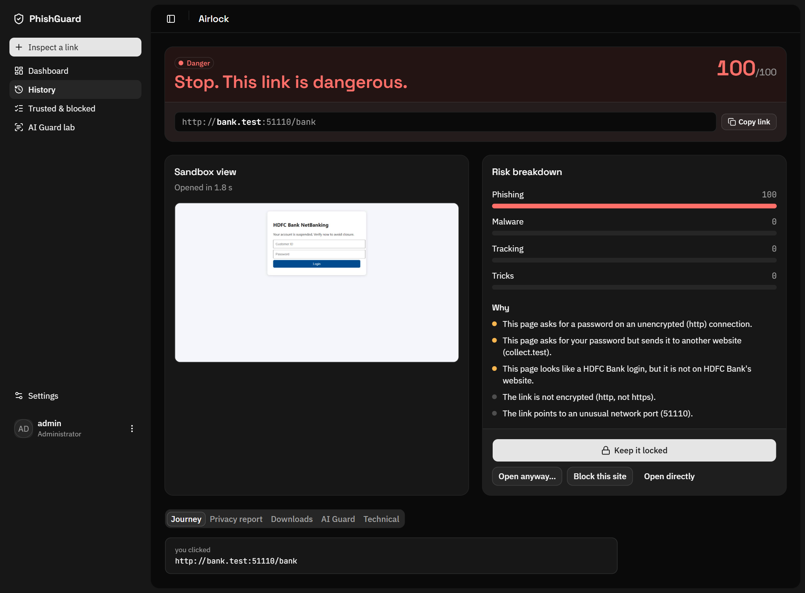
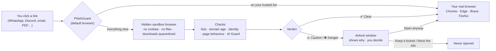
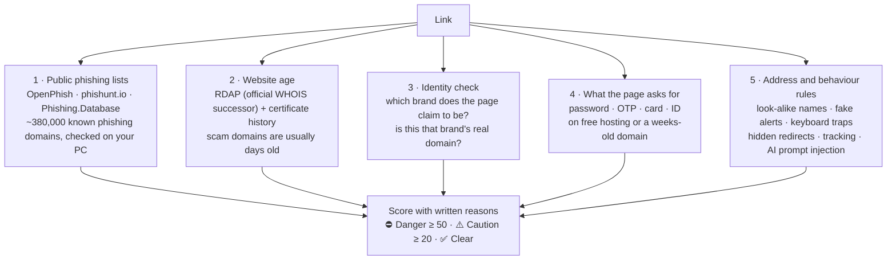
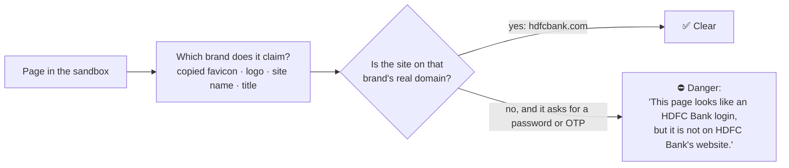
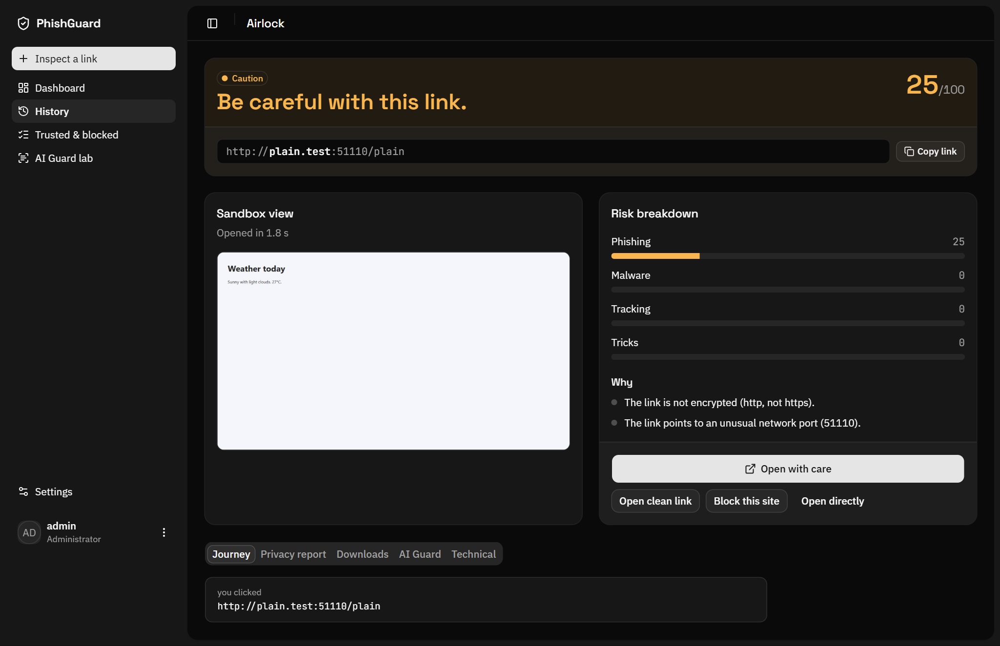
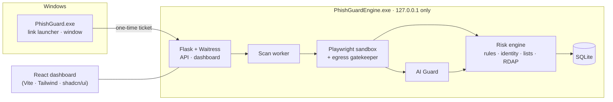

<div align="center">


# PhishGuard

**Every link checked in a sandbox before it reaches your browser.**

A free, open-source link airlock for Windows. Click a link anywhere (WhatsApp Web, Discord, email, a PDF) and PhishGuard opens it in a hidden, throwaway browser first. It tells you whether the page is a fake bank login, a malware download or a scam, and **you** decide whether to open it.

[](#install)
[](#build-from-source)
[](#tested-on-real-phishing)
[](#privacy)
[](#install)

[Install](#install) · [How it works](#how-it-works) · [How it spots a fake site](#how-it-spots-a-fake-site) · [Results](#tested-on-real-phishing) · [Privacy](#privacy) · [Build](#build-from-source)



</div>

---

## Why

Phishing no longer looks fake. A message says your bank account is suspended, the link looks right, and the login page is a pixel-perfect copy. Antivirus usually reacts *after* a site is reported, and a brand-new phishing site is reported hours after people have already typed their passwords into it.

PhishGuard sits **between the click and the browser**:

- 🔒 **Nothing opens unchecked.** The link loads in an isolated sandbox browser that has no access to your cookies, passwords or files.
- 🏦 **It knows which site is real.** A page that looks like HDFC Bank but isn't on HDFC Bank's domain is stopped, however the address is spelled.
- 📦 **Downloads never run.** Every file the site tries to drop is caught in quarantine and identified by its contents.
- 🧾 **Every warning says why,** in plain words. No black-box score.
- 💸 **Free, local and private.** No account, no cloud, no subscription.

## How it works



1. **PhishGuard registers as a browser** with Windows (current user only, no admin rights). You pick it once in *Settings → Default apps*.
2. **Trusted sites open instantly** (under 0.3 s), straight in your real browser.
3. **Every other link opens in the sandbox**: a separate Chromium with a throwaway profile, a strict network gatekeeper and a 20-second limit. It records redirects, forms, scripts, trackers, permission prompts, downloads and a screenshot.
4. **The Airlock window** shows the verdict, the screenshot and every reason. Safe links go to your real browser; PhishGuard starts it directly, so links never loop back.

## How it spots a fake site

PhishGuard does not guess from how a page *looks*. It combines five independent layers. Any one can raise the alarm, and each finding is written out in plain language.



### HDFC is never mistaken for HSBC

Many real brands look alike on paper: HDFC and HSBC, Axis and Apex, booking and cooking. Comparing spellings either misses fakes or flags real sites. PhishGuard uses the method from the research systems **Phishpedia** (USENIX Security 2021) and **PhishIntention** (USENIX Security 2022):



- **107 brands** (Indian banks and payment apps, government services, global brands) with their real domains and **284 favicon fingerprints**.
- Understands India's new **`.bank.in`** and **`.gov.in`** zones, which only verified owners can register.
- **Free hosting** (blogspot, vercel.app, pages.dev, firebaseapp…) is never trusted as a brand: that is where most phishing lives today.
- **News sites and forums** writing about a bank are not impersonations.

### More than phishing

| Threat | What PhishGuard does |
|---|---|
| Malware downloads | Every download is caught in quarantine and never run. The real file type is identified from its contents, so `invoice.pdf.exe` is exposed. |
| Tech-support scams | Detects fake virus alerts, full-screen traps and keyboard locks. |
| Tracking | Lists the trackers, fingerprinting scripts and IP loggers each site uses (shown as a privacy report, kept separate from the danger score). |
| AI prompt injection | **AI Guard**, a 1.3 MB model trained for this project, finds hidden text written to trick AI assistants (F1 0.915, 3 ms per page). |
| Your IP address | Optional **Hide my IP**: the sandbox reaches the site through Tor, Cloudflare WARP or your own proxy. |

## Tested on real phishing

Live phishing links from OpenPhish and phishunt.io, plus real websites, were opened in the sandbox on 6 Nov 2026. The **held-out** batch was collected after the rules were written and scored once.

| Held-out batch: 71 phishing pages, 61 real sites | Previous version | PhishGuard now, **without** the lists |
|---|---:|---:|
| Phishing called **Danger** | 6% | **45%** |
| Phishing **warned** (Danger or Caution) | 45% | **87%** |
| Real sites wrongly warned | 10% | **0–5%** |

- The "without the lists" column is what matters for a **brand-new** phishing site that nobody has reported yet. With the lists, every test link was caught, but that is because the links came from those same lists.
- Some phishing links showed the sandbox a decoy page (a real Google page, a "403"). Only the lists and the address rules can catch those; they are reported separately.
- Samples are small (60–110 pages per group), so each figure is uncertain by about ±10 points. The full tables, every miss and every false alarm are in [`proof/phase-9-detection`](proof/phase-9-detection/SUMMARY.md).

<div align="center">

</div>

## Install

1. Download **`PhishGuard-Setup-1.1.0.exe`** from [Releases](../../releases).
2. Run it. It installs for your Windows account only: no admin rights.
3. Open PhishGuard and press **Make PhishGuard my default browser**. Windows opens its Settings on PhishGuard's page; press **Set default**.
4. Choose **your real browser** in Settings → General. Safe links open there.

PhishGuard starts quietly with Windows (you can turn this off), so the first link you click is checked straight away.

> **Windows SmartScreen** may warn that the installer is from an unknown publisher, because it is not code-signed yet. Choose *More info → Run anyway*, or build it yourself from source.

## Privacy

- **Everything runs on your PC.** Verdicts, screenshots and history stay in `%LOCALAPPDATA%\PhishGuard`, readable only by your Windows account.
- **The phishing lists are downloaded** and checked locally. Your links are never sent to a lookup service.
- **Website age lookups send only the domain name** (never the full link), and skip popular sites and brands' own domains.
- **The AI second opinion is off by default.** If you turn it on, only the page's text goes to the provider you choose (Gemini, Groq, or Ollama running offline on your PC). AI Guard checks that text for hidden instructions first.
- History is deleted after 90 days by default (Settings → Privacy).

## Build from source

Requires Windows 10/11, Python 3.12 and Node 20+.

```powershell
git clone https://github.com/nikylogic/PhishGuard.git
cd PhishGuard
python -m venv .venv
.venv\Scripts\pip install -r requirements.txt
.venv\Scripts\python -m playwright install chromium   # only needed if Chrome/Edge is not installed

cd web; npm ci; npm run build; cd ..                   # the dashboard UI

.venv\Scripts\python run.py                            # engine on http://127.0.0.1:5157
.venv\Scripts\python scripts\register_windows.py       # register as a browser for your account
```

Run the tests with `.venv\Scripts\python -m pytest`. Build the installer with PyInstaller (`packaging/PhishGuard.spec`) and Inno Setup (`packaging/PhishGuard.iss`).



| Part | Built with |
|---|---|
| Engine | Python 3.12, Flask, Waitress, SQLite |
| Sandbox | Playwright with the installed Chrome or Edge, throwaway profile, local egress proxy |
| Detection | tldextract, Tranco top-10k, RDAP, crt.sh, public phishing lists |
| AI Guard | scikit-learn (TF-IDF + logistic regression) |
| UI | React, Vite, Tailwind CSS, shadcn/ui, pywebview |
| Installer | PyInstaller, Inno Setup |

Design details are in [`ARCHITECTURE.md`](ARCHITECTURE.md). Each build phase has its own test output and evidence in [`proof/`](proof).

## Security of PhishGuard itself

A tool that opens dangerous links must not become the way in. The engine listens on `127.0.0.1` only. The pages use a strict Content-Security-Policy with per-page nonces and no inline scripts. Every write needs a CSRF token, and the launcher authenticates with a secret token. Non-web links (`javascript:`, `file:`, `ms-msdt:`…) and links with hidden characters are refused outright. If anything fails, the link stays closed.

Found a vulnerability? Please open a private security advisory on this repository rather than a public issue.

## Contributing

The easiest way to help is to **add a brand**. Each one is a single line in [`phishguard/data/brands.json`](phishguard/data/brands.json): the name, its real domains and the words it is known by. Banks, wallets and payment apps from your country are especially welcome. Missed phishing pages and false alarms are just as valuable: open an issue with the link (defanged, e.g. `hxxps://example[.]com`) and what PhishGuard said.

## Credits

Phishing data from [OpenPhish](https://openphish.com) (community feed), [phishunt.io](https://phishunt.io) (CC0) and [Phishing.Database](https://github.com/Phishing-Database/Phishing.Database) (MIT). Popularity ranks from the [Tranco list](https://tranco-list.eu). The identity check follows the ideas of [Phishpedia](https://www.usenix.org/conference/usenixsecurity21/presentation/lin) and [PhishIntention](https://www.usenix.org/conference/usenixsecurity22/presentation/liu-ruofan).

<div align="center">

**If PhishGuard saved you from one bad click, give it a ⭐ so more people find it.**

</div>
